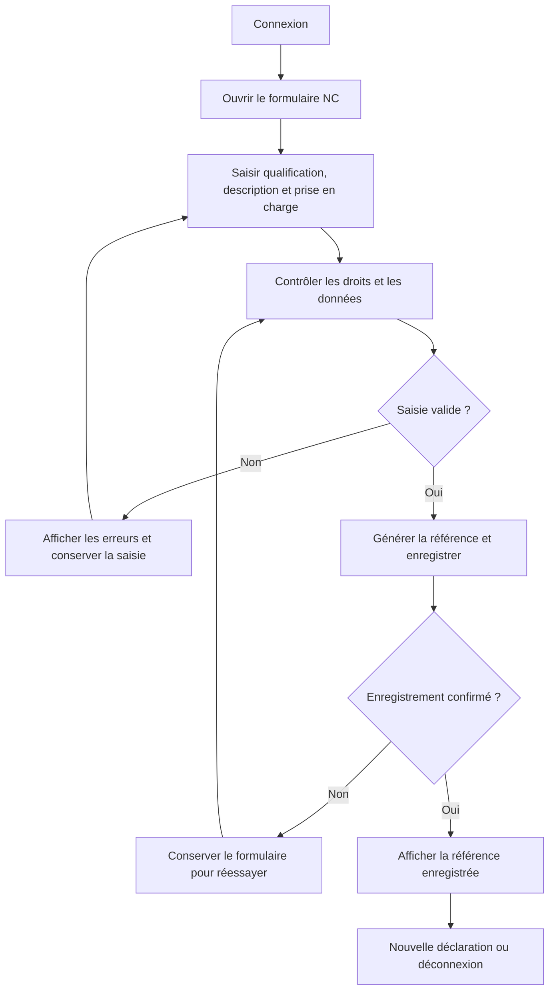

# Processus : enregistrer une non-conformité

Le processus commence lorsqu'un collaborateur veut déclarer un problème.
Il se termine par la confirmation d'une référence enregistrée. Le choix de
commencer par une NC reste une proposition soumise à D01/D02.

| Étape | Acteur | Résultat attendu |
| --- | --- | --- |
| Se connecter | Collaborateur | Compte valide identifié par son matricule. |
| Saisir | Collaborateur autorisé | Processus, type, nature, description, traitement, responsable et échéance éventuelle. |
| Contrôler | Application | Droits, contraintes des champs, référentiels actifs et responsable autorisé vérifiés. |
| Enregistrer | Application | Référence, NC et audit technique dans une même transaction. |
| Confirmer | Application | Référence de la création liée à la session, après réussite seulement. |
| Recommencer ou quitter | Collaborateur | Nouveau formulaire ou fin de session. |

Le déclarant, la référence, la date et le statut initial `OUVERTE` sont
déterminés par le serveur. Le rôle du traitement, le choix du responsable et
l'obligation d'échéance restent soumis aux [questions métier](06-decisions.md).

Une erreur de saisie conserve les champs à l'écran sans créer de dossier.
Une erreur avant confirmation de la transaction ne doit pas afficher de succès.
Si la réponse est perdue, le même formulaire peut être renvoyé pour retrouver
son résultat sans créer une seconde NC. La conservation à l'écran n'est pas
une sauvegarde de brouillon en base.
