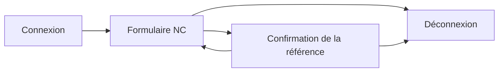

# Écrans et champs du premier parcours

## Enchaînement des écrans

| Écran | Contenu et actions | États à prévoir |
| --- | --- | --- |
| Connexion | Matricule, mot de passe, Se connecter. | Identifiants incorrects, compte hors validité, accès autorisé. |
| Formulaire NC | Qualification, description, traitement, responsable, échéance ; Enregistrer et Se déconnecter. | Champs requis, erreurs par champ, saisie conservée, enregistrement en cours, échec. |
| Confirmation | Référence enregistrée ; Nouvelle déclaration et Se déconnecter. | Confirmation de la dernière création liée à la session. |

La confirmation ne demande pas d'identifiant de dossier à l'utilisateur.
Elle affiche uniquement la référence enregistrée pour la session courante.

## Organisation du formulaire

1. Qualification : processus, type de NC et nature de service.
2. Constat : description du problème.
3. Prise en charge : responsable et traitement, selon les règles à confirmer.
4. Planification : échéance éventuelle ; date de création déterminée par le serveur.
5. Enregistrement : erreurs près des champs, puis confirmation après réussite.

## Champs et contraintes existantes

Source : [table `non_conformites`](../../database/001_schema.sql).

| Champ | Type SQL | Usage du formulaire |
| --- | --- | --- |
| `processus_id` | `INT UNSIGNED`, non nul, clé étrangère | Processus actif à sélectionner. |
| `type_nc_id` | `INT UNSIGNED`, non nul, clé étrangère | Type actif à sélectionner. |
| `nature_service_id` | `INT UNSIGNED`, non nul, clé étrangère | Nature active à sélectionner. |
| `description` | `TEXT`, non nul | Constat non vide. |
| `traitement` | `TEXT`, non nul | Sens et auteur à confirmer dans D03. |
| `responsable_matricule` | `VARCHAR(60) COLLATE utf8mb4_bin`, non nul | Personne existante et autorisée ; choix métier à confirmer. |
| `date_echeance` | `DATE`, nullable | Si renseignée, ne précède pas la création ; obligation selon D04. |

Le serveur renseigne `enregistree_par_matricule` avec le compte connecté,
`reference` (`VARCHAR(50)`) avec la procédure SQL, `date_creation` avec la date
du jour dans le fuseau configuré et `statut_code` avec `OUVERTE`.

Les matricules restent des chaînes : conserver les zéros initiaux et la
collation existante. Refuser les valeurs trop longues sans les tronquer.
La limite de `TEXT` est de 65 535 octets ; elle ne correspond pas à un nombre
fixe de caractères UTF-8. `NOT NULL` n'interdit pas à lui seul une chaîne vide.

Les autres champs et tables du schéma sont conservés pour le projet global ;
ils n'ajoutent pas d'écrans au présent parcours.
